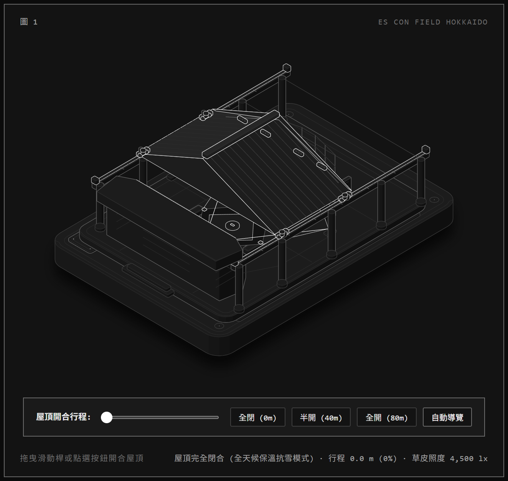

# ES CON FIELD HOKKAIDO · Retractable Roof Anatomy Figure

北海道日本火腿鬥士隊主場 **ES CON FIELD HOKKAIDO** 開閉式屋頂 Anatomy 技術圖說。

## 📌 關於本專案

本專案使用 **Anatomy** 等角投影架構，以純前端（SVG + 物理阻尼動態引擎）完整重現北海道北廣島市 F VILLAGE 的 ES CON FIELD 棒球場：
- **可動大屋頂開閉機構**：約 10,000 噸切妻鋼構大屋頂，透過雙側高架鋼桁梁軌道與 4 組電動雙輪走行台車，實現 80.0 公尺的水平滑移。
- **球場核心細節**：肯塔基藍草天然草皮、內野紅土鑽石區、投手丘、壘包、界內白線、球員休息室與防撞外野牆。
- **標誌性地標**：左外野 TOWER 11（含 4 樓露天溫泉三溫暖觀賽陽台、客房陽台與「11」號標誌）、雙側 86 公尺超大型 LED 液晶螢幕、南側 70 公尺全景採光玻璃帷幕。

## 🚀 GitHub Pages 部署說明

1. 將本資料夾內的所有檔案上傳或 Push 至您的 GitHub Repository。
2. 進入 GitHub Repository 的 **Settings** -> **Pages**。
3. 在 **Branch** 選取 `main`（或 `master`），資料夾選取 `/ (root)`，點擊 **Save**。
4. 幾秒後即可在 `https://<您的帳號>.github.io/<專案名稱>/` 線上直接體驗互動！

## 📂 檔案架構

- `index.html`：深色主題主要展示頁（支援滑桿拖曳、按鈕切換、鍵盤控制與即時讀數）
- `light.html`：淺色紙本工程圖風格版本
- `preview-closed.png`：屋頂閉合展示圖
- `preview-open.png`：屋頂全開展示圖
